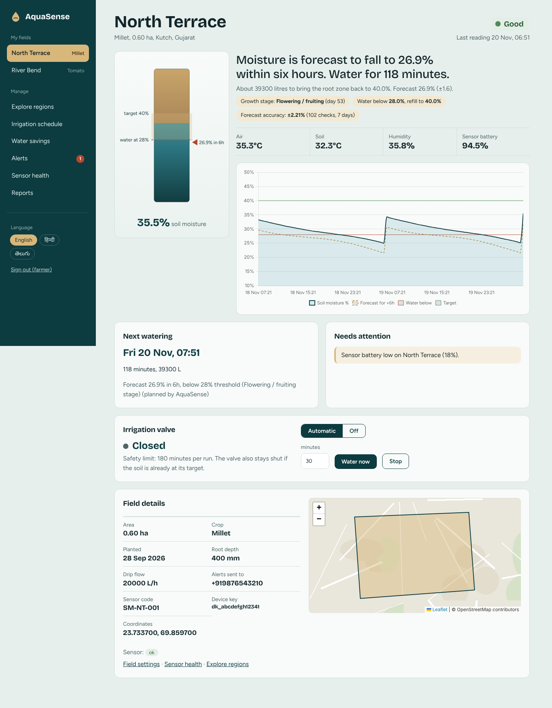
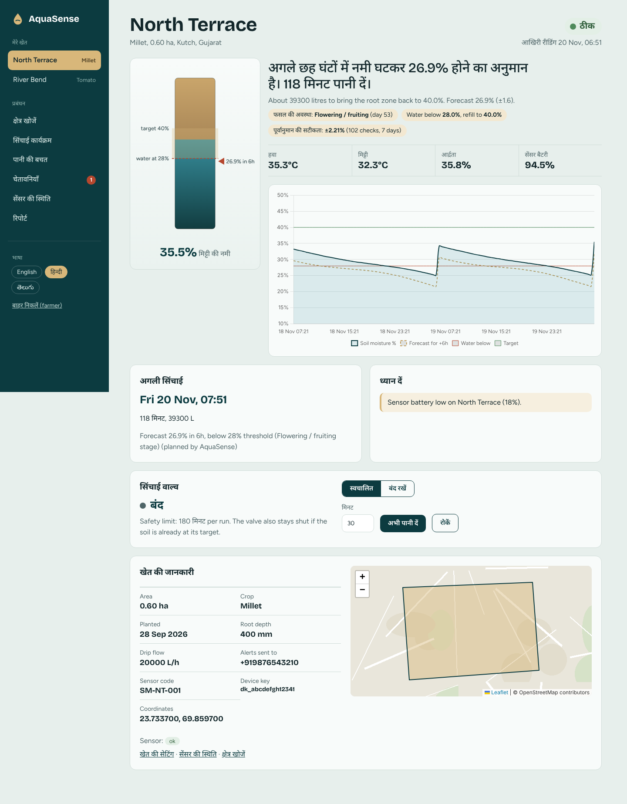
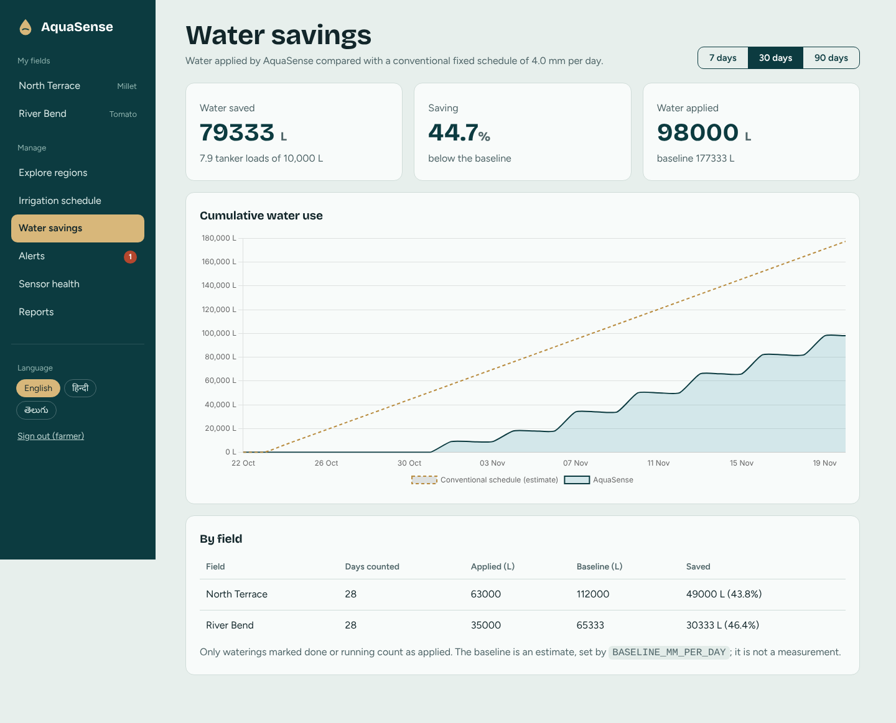
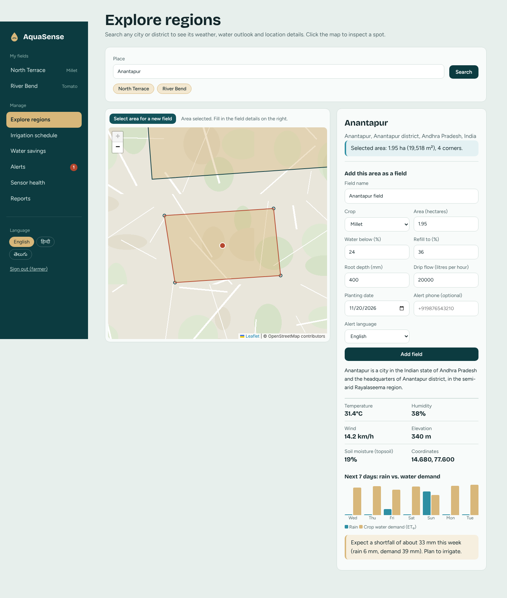
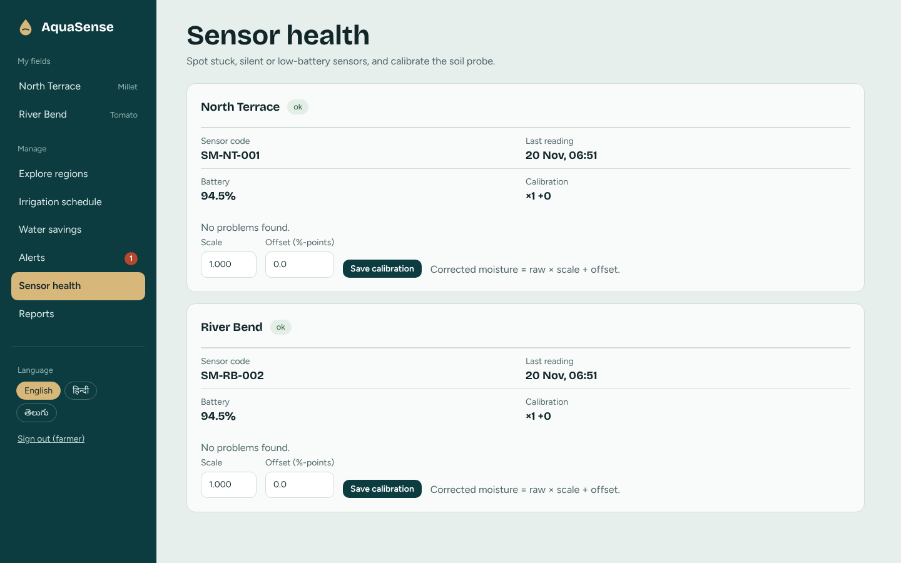
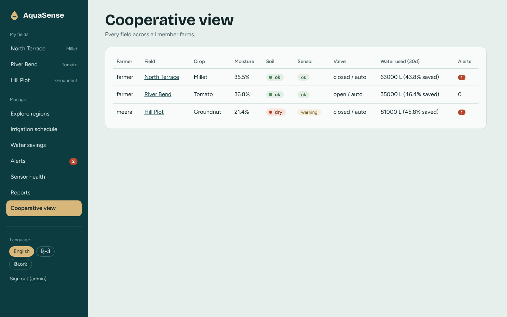

# AquaSense: Precision Irrigation for Smallholder Farmers

Soil-moisture sensors feed a TensorFlow forecaster that predicts moisture six hours ahead. AquaSense plans
irrigation around crop growth stage and incoming rain, can open and close the valve itself, and tells farmers by
SMS or WhatsApp in their own language. A Django dashboard lets them watch and adjust everything.

```
ESP32 sensor + valve  <--HTTP-->  Flask API  --SQL-->  MySQL  <--ORM--  Django dashboard (PWA)
  (offline buffering)             TensorFlow model                      login, map, charts, reports
                                  rain forecast, SMS/WhatsApp
                shared logic: aquacore/ (planner, valve safety, sensor health, savings, translations)
```

| Layer | Tech | Folder |
|---|---|---|
| Sensors and valve controller | ESP32 + soil probe + DHT22 + relay, or the Python simulator | `iot/` |
| Preprocessing and ML | Python 3.9, TensorFlow 2.x | `ml/` |
| Ingestion, planning, valve and alert API | Flask | `api/` |
| Farmer dashboard, map, reports | Django 4.2, Leaflet, ReportLab | `dashboard/` |
| Shared, dependency-free logic | plain Python | `aquacore/` |
| Storage | MySQL 8 | `database/` |

## Preview

| Field dashboard | Hindi |
|---|---|
|  |  |
|  |  |
|  |  |

*Screenshots use sample data and placeholder map tiles.*

## Features

- **Rain-aware watering:** the planner reads a 12-hour rain forecast (Open-Meteo). A small deficit that rain will
  cover is skipped; a larger one is reduced by the expected rain.
- **Growth-stage thresholds:** set a planting date and the watering threshold and refill level shift with the crop
  stage (establishment, vegetative, flowering, maturity). Stage lengths in `aquacore/planner.py` are starting
  points; check them against local agronomic advice.
- **Forecast confidence and accuracy:** each forecast shows a band, and the dashboard compares past predictions with
  what actually happened over the last 7 days.
- **Automatic valve control:** the ESP32 polls `/api/devices/<code>/command`. Safety rules: valve closed on every
  boot, local timer on every run, a per-field maximum run time (hard cap 240 min), no watering when the soil is
  already at target, a farmer-controlled Off mode, manual Water now and Stop, and a server-side cleanup if a run is
  never acknowledged.
- **Water savings:** litres applied versus an estimated conventional fixed schedule (`BASELINE_MM_PER_DAY`, default
  4 mm/day). It is an estimate, not a measurement.
- **SMS / WhatsApp alerts** in English, Hindi or Telugu through Twilio (optional). Without Twilio credentials,
  messages are saved to an outbox and shown on the Alerts page.
- **Local-language screens:** English, Hindi and Telugu for the main navigation and dashboard, with a large
  Good / Dry / Wet status badge for low-literacy use. The Hindi and Telugu text is a first draft: have a native
  speaker review it, and extend `aquacore/i18n.py` for the remaining pages.
- **Sensor health and calibration:** detects offline, stuck, jumping and low-battery sensors, and lets you set a
  calibration scale and offset per probe.
- **Offline-friendly sensing:** the ESP32 buffers readings in RTC memory and uploads them in one batch
  (`POST /api/readings/batch`) when the network returns.
- **Login and roles:** farmers see only their own fields; staff accounts get everything plus the Cooperative view.
  Per-device API keys are generated for each new field.
- **Installable app (PWA):** add it to a phone's home screen; recently viewed pages stay available offline.
  Needs HTTPS in production (localhost works for testing).
- **Reports:** water-use PDF, plus CSV export of readings, waterings and alerts.
- **Explore regions:** search any city or district, outline land on the map to add a field, and see weather and a
  7-day water outlook.

## Quick start with Docker

1. Copy `.env.example` to `.env`.
2. Replace `MYSQL_PASSWORD`, `MYSQL_ROOT_PASSWORD`, `API_KEY`, and `DJANGO_SECRET_KEY` with unique, strong values. For example, generate values with `python -c "import secrets; print(secrets.token_urlsafe(32))"` (run separately for each secret).
3. Keep `.env` private; it is excluded by `.gitignore`.
4. Start the stack:

```bash
docker compose up --build                      # MySQL, API, dashboard (first start trains the model)
docker compose --profile demo up --build       # also starts simulated sensors
docker compose logs dashboard                  # shows generated demo logins once
```

Open http://localhost:8000. Docker startup rejects missing or obvious placeholder API/Django secrets rather than silently using public defaults. For a public deployment, set `DJANGO_ALLOWED_HOSTS` to the exact hostnames and put HTTPS/reverse-proxy termination in front of the services.

## Quick start without Docker (Python 3.9)

```bash
python3.9 -m venv .venv && source .venv/bin/activate      # Windows: .venv\Scripts\activate
pip install -r requirements.txt
cp .env.example .env

docker compose up -d mysql            # or: mysql -u root -p < database/schema.sql

cd ml && python train.py && cd ..     # trains the model -> ml/models/
python api/app.py                     # terminal 1: Flask on :5001
python iot/simulator.py --backfill 60 # terminal 2: simulated sensors and valve

cd dashboard
python manage.py migrate              # Django's own auth/session tables
python manage.py create_demo_users    # prints admin and farmer passwords once
python manage.py runserver            # terminal 3: http://127.0.0.1:8000
```

Without a trained model the API falls back to a simple evaporation estimate, so the stack still runs.

**Upgrading an existing database?** Run `database/upgrade_v2.sql` once, then `python manage.py migrate`.

## Tests

```bash
./run_tests.sh      # 76 tests, no MySQL or TensorFlow needed
```

Unit tests cover the planner, valve safety, sensor health, savings, translations and timezone handling. API tests
exercise ingestion, rain skipping, calibration, batch upload, valve commands and alerts against an in-memory
database. Dashboard tests cover login, per-farmer isolation, field creation, the valve controls, reports and exports.

## Configuration (`.env`)

| Variable | Purpose |
|---|---|
| `API_KEY` | Strong shared key for legacy sensors and trusted dashboard-to-API forecast requests; sensors with their own device key must use only that key |
| `APP_TIMEZONE` | Timezone for the API and dashboard, default `Asia/Kolkata`. Both must use the same value |
| `MYSQL_PASSWORD`, `MYSQL_ROOT_PASSWORD` | Unique database credentials; required by Docker Compose |
| `DJANGO_SECRET_KEY`, `DJANGO_ALLOWED_HOSTS` | Django signing secret and comma-separated allowed hostnames |
| `BASELINE_MM_PER_DAY` | Conventional-schedule estimate for the savings page |
| `TWILIO_ACCOUNT_SID`, `TWILIO_AUTH_TOKEN`, `TWILIO_FROM`, `NOTIFY_CHANNEL` | Optional SMS or WhatsApp (`sms` or `whatsapp`) |

Add each field's alert phone number (international format) and language in **Field settings**.

## Hardware

`iot/esp32_soil_sensor.ino` reads a capacitive soil probe and DHT22, buffers readings offline, and drives a relay
for a solenoid valve. Set `DEVICE` and `API_KEY` to the sensor code and device key on the field page, and calibrate
`AIR_DRY` / `AIR_WET` for your probe. Wire the relay for fail-safe operation (valve closed when unpowered).

## API

| Method | Path | Purpose |
|---|---|---|
| POST | `/api/readings` | Ingest a reading (header `X-API-Key`) |
| POST | `/api/readings/batch` | Upload up to 200 buffered readings, each with `age_s` |
| GET | `/api/predict/<field_id>` | 6 h forecast, band, rain credit, growth stage, watering advice |
| GET | `/api/devices/<code>/command` | Valve controller poll: `open`, `close` or `idle` |
| POST | `/api/devices/<code>/ack` | Valve controller reports `done` or `failed` |
| GET | `/api/health` | Status and active model |

## Known limits

- `ml/generate_data.py` produces synthetic data. Retrain on real sensor exports as they accumulate.
- The ESP32 firmware has not been compiled or run on hardware in this project's test environment. Bench-test the
  relay and the fail-safe behaviour before connecting a real valve.
- LoRa and MQTT are not included. A LoRa or MQTT gateway can forward readings to `/api/readings/batch`.
- Docker setup is provided but was not run in the build environment.
- Before public deployment: HTTPS, strong secrets, and a reverse proxy in front of both services.
